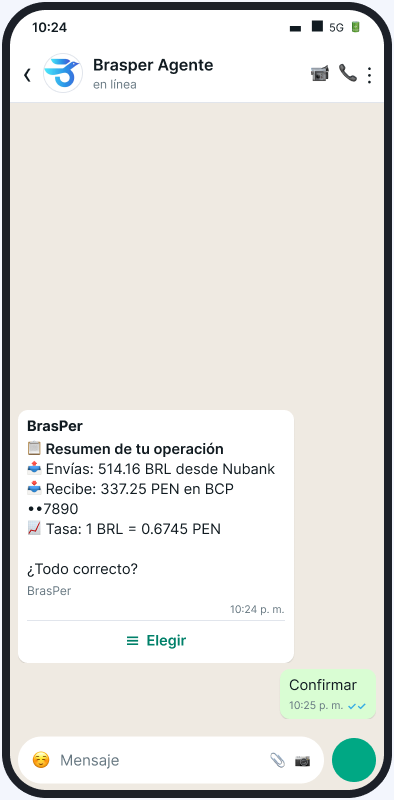
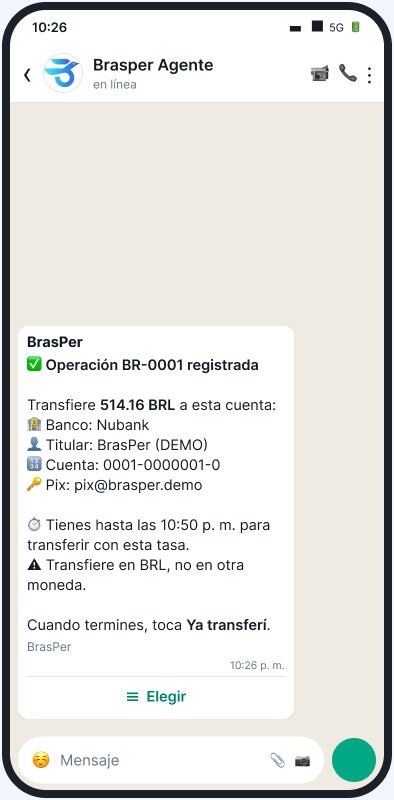
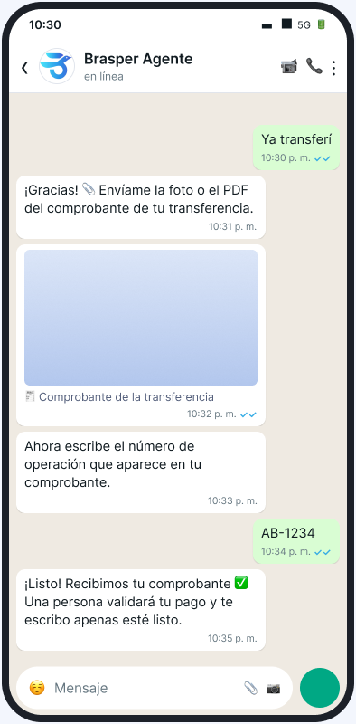
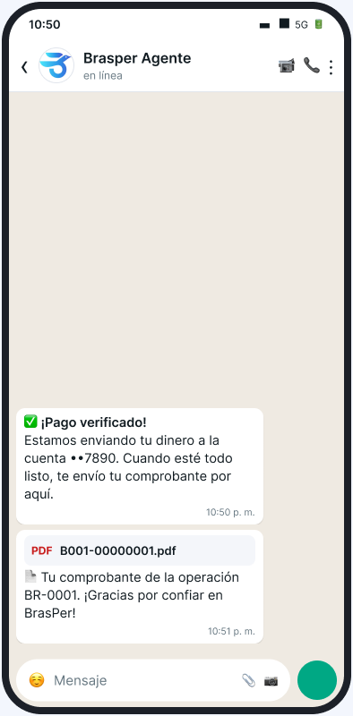
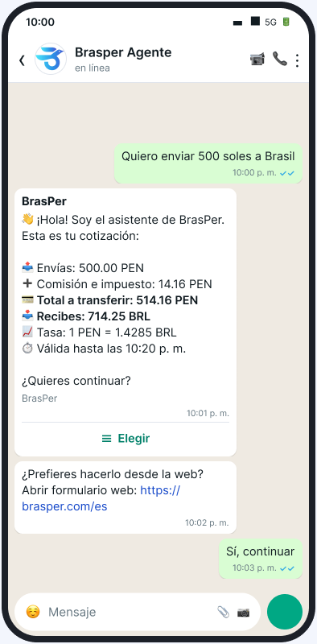
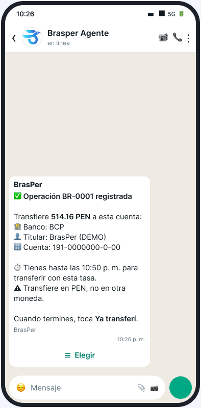
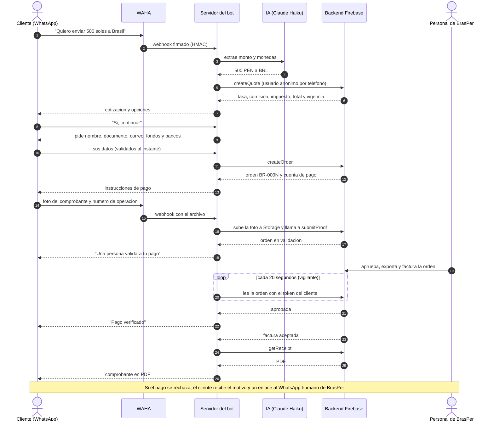

# BrasPer · Agente de WhatsApp para remesas

Un agente de WhatsApp que cotiza una remesa entre **soles (PEN), reales (BRL) y dólares (USD)**, registra la operación en el backend real de BrasPer, recibe la foto del comprobante, avisa cuando el pago se verifica y entrega el **comprobante en PDF**, todo dentro del chat.

Reto de la IAthon: *mejorar el proceso de ventas y facturación de BrasPer*. Hoy, 4 personas de Ventas y 3 de Facturación atienden a mano unas 60 transacciones diarias por WhatsApp, y el cliente puede esperar hasta 3 días por su comprobante.

<table>
  <tr>
    <td align="center"><br><sub>1. Cotiza</sub></td>
    <td align="center"><br><sub>2. Confirma</sub></td>
    <td align="center"><br><sub>3. Recibe cómo pagar</sub></td>
    <td align="center"><br><sub>4. Envía el comprobante</sub></td>
    <td align="center"><br><sub>5. Pago verificado y PDF</sub></td>
  </tr>
</table>

> Las capturas son maquetas hechas con los textos reales del bot y datos de demostración.

## Qué hace

- **Entiende la remesa en una frase** ("Quiero enviar 500 soles a Brasil"): una IA (Claude Haiku) extrae solo el monto y las monedas. Las tasas, comisiones y estados los entrega siempre el backend, nunca el modelo.
- **Conversación de pasos fijos**: cotización, datos del cliente, cuentas, resumen, pago y comprobante. Cada error dice qué hacer y el segundo fallo seguido pasa a una persona.
- **Backend real de BrasPer** (Firebase): cotiza con `createQuote`, crea la orden con `createOrder`, sube la foto a Storage y registra el pago con `submitProof`.
- **Una persona valida el pago**: la IA nunca aprueba ni juzga un comprobante.
- **Avisos y recibo automáticos**: un vigilante lee el estado de la orden y avisa la aprobación (o el rechazo); cuando la factura queda aceptada, envía el PDF real.
- **Dos sentidos**: Brasil → Perú (BRL → PEN, con Pix) y Perú → Brasil (PEN → BRL).
- **Sin credenciales de administrador**: el bot actúa como un usuario anónimo de Firebase por teléfono; las reglas del proyecto aíslan a cada cliente.

### Perú → Brasil

<table>
  <tr>
    <td align="center"><br><sub>Cotización en soles</sub></td>
    <td align="center"><br><sub>Cómo pagar en soles (sin Pix)</sub></td>
  </tr>
</table>

## Cómo interactúa el cliente con el flujo



## Arquitectura

```
WhatsApp ⇄ WAHA (Docker) ⇄ Servidor Node ── Motor de flujo ── Backend
                                │                              ├─ real      → funciones, Firestore y Storage (Firebase)
                                │                              └─ simulado  → API de demostración (modo de respaldo)
                                └─ SQLite: conversaciones, sesiones, seguimientos
```

| Carpeta | Qué contiene |
|---|---|
| `waha/` | El bot: servidor, motor de flujo, backend real, vigilante, pruebas. Ver [`waha/README.md`](waha/README.md). |
| `kapso/` | El flujo original en Kapso y la API simulada que usa el modo `simulado`. |
| `docs/superpowers/` | Diseños (specs) y planes de implementación. |
| `.env.example` | Variables de entorno (obligatorias y opcionales). |

## Cómo ejecutarlo

### Requisitos
- **Node 24** o superior (sin dependencias de npm) y **Docker** con Compose.
- Un **número de WhatsApp dedicado** para vincular a WAHA (no el de uso diario).
- `ANTHROPIC_API_KEY` (la IA) y, para el modo real, `FIREBASE_API_KEY` (la clave web pública del proyecto de BrasPer).

> **WAHA no es una vía oficial de WhatsApp**: el número puede restringirse o bloquearse. Es para la demo y el hackathon. Para producción se usaría la API oficial de WhatsApp.

### 1. Probar sin nada instalado (modo simulado)
```bash
git clone https://github.com/davidrodriguez2712/iaton-proyecto
cd iaton-proyecto
npm --prefix waha test        # 268 pruebas del bot
npm --prefix kapso test       # 58 pruebas del flujo original
```

### 2. Levantar el bot con WhatsApp
```bash
cp .env.example .env          # completa ANTHROPIC_API_KEY y, para el modo real, BACKEND=real y FIREBASE_API_KEY
cd waha
npm run setup                 # genera los secretos de WAHA en waha/.env (no los muestra)
docker compose up -d waha     # WAHA; en x86 usa WAHA_TAG=latest
npm run sesion                # crea la sesión "demo" con el webhook firmado
```
Abre `http://127.0.0.1:3010/dashboard` (usuario y contraseña en `waha/.env`), pide el QR de la sesión `demo` y escanéalo desde WhatsApp → *Dispositivos vinculados*. Cuando la sesión esté en `WORKING`:
```bash
npm start                     # servidor en 127.0.0.1:8010
npm run preflight -- --ia     # comprueba WAHA, el servidor, la base, la clave y la IA
```

### 3. Probarlo desde tu teléfono
Escribe al número vinculado: **"Quiero enviar 500 soles a Brasil"**. Antes de cada demo puedes limpiar tu estado con `npm run demo:reset -- <teléfono>` (código de país, sin `+`).

### Modo real contra Firebase
Con `BACKEND=real` el bot usa el backend del equipo (proyecto Firebase `aibrasper`, base de **pruebas**). `npm run contrato` repite contra el proyecto real las llamadas seguras y comprueba que su forma coincide con la del servidor falso de las pruebas; no crea órdenes. El backend vive en [binnicordova/iathon-fintech](https://github.com/binnicordova/iathon-fintech). Más detalle en [`waha/README.md`](waha/README.md).

### Variables de entorno
Todas están en [`.env.example`](.env.example); solo 10 son obligatorias y el resto tiene un valor por defecto.

## Privacidad y seguridad

- Sin credenciales de administrador: el bot usa la clave web pública de Firebase y un usuario anónimo por teléfono.
- Los registros guardan ids, estados y latencias; nunca documento, correo, cuentas ni la foto. Los teléfonos se enmascaran.
- Los datos personales salen del estado de la conversación en cuanto se crea la orden, y las conversaciones inactivas se borran a las 24 horas.
- La base SQLite y sus archivos quedan con permisos 600.

---

Hecho por **David Rodriguez** para la **IAthon Construye Perú (IATHON)**, reto de **BRASPER**.
